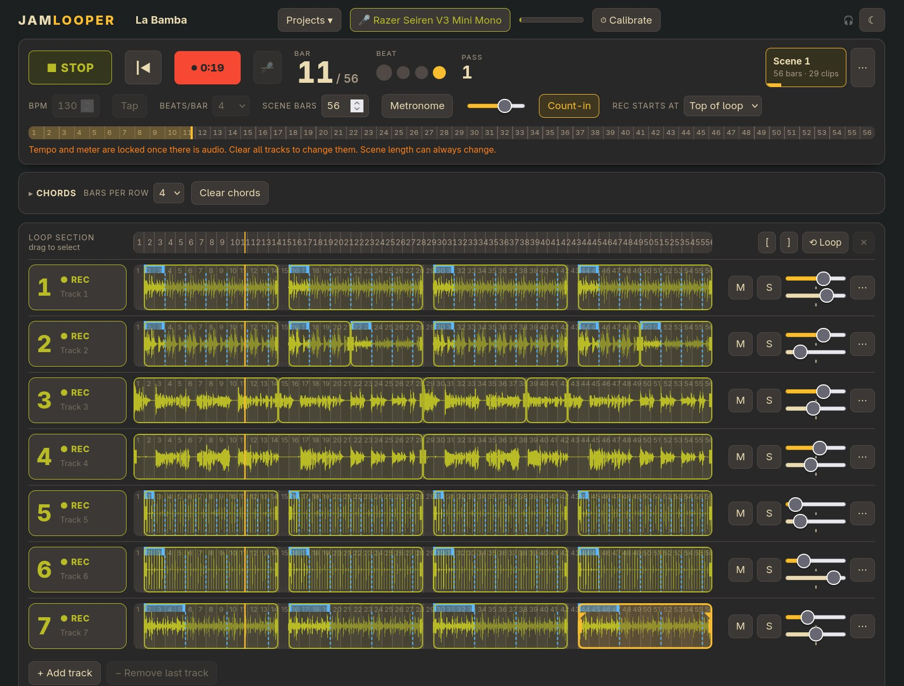

# Jam Looper

A multitrack loop station that runs in your browser. Record from your mic, arrange and loop clips, mute and solo tracks, switch between scenes, and export the mix as a WAV. It's one HTML file with no build step and no dependencies.

**[▶ Try it live](https://trymoto.github.io/jam-looper/)**



## Features

- **Multitrack recording** from any audio input, with per-track volume, pan, mute and solo. Takes are as long as you play, rounded up to whole bars
- **Clips**: several per track. Move and crop them, or turn on looping and pick which part repeats (Ableton-style loop brace). Select a clip to drag fade-in / fade-out handles. Newer clips trim whatever they overlap
- **Loop sections**: drag on the timeline to loop and record into just a few bars
- **Scenes**: each has its own length, chords and loop section. Queue a switch to land at the end of the loop. Drag scenes to reorder them
- **Chords**: type a chord chart over each scene's bars
- **Metronome, count-in and tap tempo**
- **Latency calibration** so recordings line up
- **Undo / redo**
- **Export the mix** as a stereo `.wav`
- **Projects** saved in your browser (IndexedDB). Nothing gets uploaded anywhere.
- Light and dark Gruvbox themes. Works on phones and can be added to your home screen.

## Keyboard shortcuts

| Key | Action |
| --- | --- |
| `Space` | Play / stop |
| `1`–`9`, `0` | Record on track 1–10 (again to stop) |
| `Shift` + number | Mute track |
| `Alt` + number | Solo track |
| `←` / `→` | Previous / next bar (`Shift`: by beat) |
| `Home` | Go to start |
| `↑` / `↓` | BPM ±1 (`Shift`: ±5) |
| `[` / `]` | Set loop start / end here |
| `L` | Toggle loop section (`Shift+L` clears it) |
| `,` / `.` | Previous / next scene |
| `R` | Toggle performance mode |
| `I` | Toggle performance input |
| `M` | Metronome |
| `C` | Count-in |
| `T` | Tap tempo |
| `B` | Rec starts at top of loop / next bar |
| `N` | New track |
| `K` | Show / hide chords |
| `E` | Export mix |
| `Ctrl/⌘+Z`, `Ctrl/⌘+Shift+Z` or `Ctrl/⌘+Y` | Undo / redo |
| `Delete` | Delete the selected clip |
| `Ctrl/⌘+C` / `Ctrl/⌘+V` | Copy the selected clip / paste it at the current bar |
| `Ctrl/⌘+D` | Duplicate the selected clip |
| `Esc` | Deselect, cancel a pending recording |

## Running locally

Open `index.html` in a browser. Mic access needs a secure context, so if your browser won't allow it from a `file://` URL, serve the folder instead:

```sh
npx serve .
# or
python -m http.server
```

Then open http://localhost:3000 (or :8000).

Use headphones while recording so the speakers don't bleed into the mic.

## Browser support

This works in any recent version of Chrome, Edge, Firefox or Safari. It needs the Web Audio API, `getUserMedia` and IndexedDB.

## Contributing

Issues and pull requests are welcome. The whole app lives in `index.html`: the styles, markup and script are all inline.

## License

[MIT](LICENSE)
